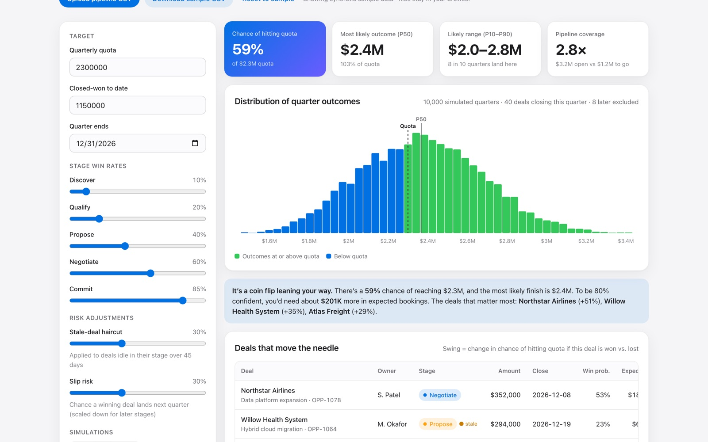

# Quota Lens

Monte Carlo pipeline forecasting: turn a list of open deals into a probability of hitting quota, and find the deals that actually move it.

**[Live demo →](https://darshanpatil.me/work/quota-lens/)**



## The problem

Sales forecasts are usually a single number: weighted pipeline, or a rep's gut-feel "commit." Neither says how *likely* the team is to hit quota, and neither says which deals matter most. Leaders end up spending executive time on the biggest deals instead of the ones that change the outcome.

## What it does

- Runs 2,000–50,000 simulated quarters of the open pipeline.
- Reports the **probability of hitting quota**, the most likely outcome (P50), and an 80% range (P10–P90).
- Ranks every deal by **swing**: how much the chance of hitting quota changes depending on whether that deal is won.
- Adjusts for stalled deals and timing risk, and breaks expected bookings down by rep and stage.
- Accepts your own pipeline as CSV.

## How it works

1. **Score each deal.** Start from the stage's win rate (adjustable). Deals idle in their stage for more than 45 days get a configurable haircut.
2. **Account for timing.** A won deal still has to close *this quarter*. Each deal carries slip risk that's highest in early stages and lowest at Commit.
3. **Simulate.** In each run every deal is independently won or lost with its probability, and wins are added to closed-won to date. Thousands of runs form the outcome distribution.
4. **Measure swing.** For each deal, compare P(hit quota) across runs where it was won vs. lost. This conditional difference comes from the same simulation, so no extra runs are needed.

**CSV format:** `deal_id, deal, account, owner, stage, amount, close_date, days_in_stage`. Stages: Discover, Qualify, Propose, Negotiate, Commit.

**Limitations:** deals are treated as independent, and win rates are inputs rather than learned from history. The natural next step would be to calibrate them from closed-won/lost data.

## Run it locally

No build step and no dependencies. Serve the folder with any static server:

```bash
python3 -m http.server 8000
# open http://localhost:8000
```

## Project structure

```
index.html   page layout and copy
app.js       data generation, model, and rendering
app.css      page-specific styles
kit.js       shared helpers: seeded RNG, CSV import/export, SVG charts, tooltips
kit.css      shared UI kit (light + dark mode)
```

Charts are hand-built SVG with no charting library. Everything runs client-side, so uploaded files never leave the browser.

## Data

The bundled sample data is **synthetic**, generated from a seeded random process so it is reproducible. It does not describe any real company or customer.

---

Built by [Darshan Patil](https://darshanpatil.me) · [LinkedIn](https://www.linkedin.com/in/darshan-patil-/)
